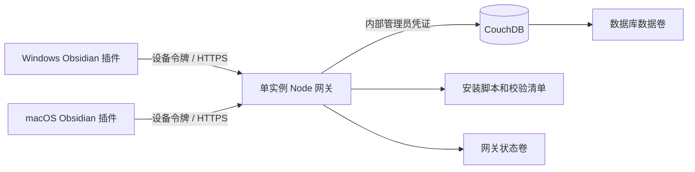

# LAN Note Sync 0.3 设计

日期：2026-11-08。替代 v0.2 的默认 SQLite 部署方案；旧版文档保留为归档。

## 产品目标

管理员部署一次，用户只做安装、选择笔记库、启用插件和首次确认。Windows 与 macOS 使用同一插件构建，不依赖 Self-hosted LiveSync 的代码、格式或发布节奏。CouchDB 提供持久化能力，本项目维护网关和同步语义。

## 技术组成

| 部分 | 实现 | 责任 |
| --- | --- | --- |
| 桌面插件 | TypeScript、Obsidian API、esbuild | 文件扫描、离线队列、首次预览、冲突与历史界面 |
| 网关 | Node.js 24.15.0，原生 HTTP/HTTPS | 设备隔离、校验、幂等提交、安装分发、数据库访问 |
| 存储 | CouchDB 3.5.3，单节点 | 正文附件、不可变业务修订、设备与控制文档 |
| 部署 | Docker Compose v2 | 两个容器、健康检查、两个持久卷、内部数据库网络 |
| 客户端安装 | PowerShell / macOS Bash 3.2 | 选库、下载校验、写入一次性连接信息 |

没有引入 Web 服务框架、PouchDB 或 CouchDB 客户端直连。选择网关是为了把数据库账号、CORS、初始化和管理留在服务端，也让客户端协议独立于存储实现。该方案没有直接采用 CouchDB/PouchDB 的复制引擎，离线队列与文件同步仍需本项目持续验证。

## 数据与同步

- `control`：数据格式版本、稳定服务器 ID、网关所有权、配对派生密钥。
- `vault:<id>`：远端笔记库。
- `pair:<code-hash>`：10 分钟邀请及首次认领请求 ID。
- `device:<token-hash>`：设备身份、所属库和撤销状态。
- `object:<vault>:<sha256>`：不可变 UTF-8 原始正文，存为二进制 `_attachments.body`。
- `revision:<vault>:<id>`：不可变业务修订，包含逻辑文件 ID、父修订、路径、删除标记、正文哈希、设备 ID，以及首次提交结果。

CouchDB `_rev` 只用于邀请认领、设备撤销等可变记录的比较交换；不作为用户历史。历史由独立的业务修订文档构成，因此 CouchDB compaction 不应丢失笔记业务版本。实际压缩测试已验证。

网关启动时从 `_changes` 重建内存索引；游标作为不透明字符串处理，不进行数值排序。服务每次启动产生新的 epoch，客户端遇到变化会重新核对完整状态，不能把重启误认为全库删除。当前索引在内存，历史增长会增加重建时间和内存使用，尚未做大型库压力验收。

先保存正文，再保存引用它的修订。提交使用固定修订 ID 重试，响应丢失后核对原提交；不会为同一操作生成新的修订。正文上传后修订失败只会留下未引用正文，不发布不完整修订。本版不自动清理孤立正文和历史。

同一文件允许多个并发头，明确保留冲突。选择版本会创建一个引用现有头的新修订。逻辑文件 ID 与路径分离，改名保持身份；大小写等路径冲突由服务端和插件检查。首次合并不把“某端没有文件”当成删除。

插件先持久化本地待提交内容和应用日志，再进行网络发布或文件替换。应用前重新检查磁盘内容，打开中的 Markdown 暂缓替换，被替换内容另存快照。批量删除分别在发送端和接收端确认。

## 简化配置

服务端 setup 自动生成 32 字节随机密码，创建 Compose 配置并初始化数据库，不展示数据库配置给笔记用户。默认回环绑定，LAN 试用需要明确开放，正式部署的域名和 TLS 由管理员配置一次。

`invite` 输出 `lansync:` 完整连接码和两种系统的一行安装命令。码内仅有协议版本、服务地址和一次性邀请码。默认远端库 ID 存在网关卷，重复邀请无需手填。

安装器只接收邀请码，下载三个插件文件并检查 SHA-256，再写入 `bootstrap.json`。插件第一次启用后自动认领并预览。`pair-claim.json` 记录固定请求 ID，网络超时或应用重启后能恢复同一次认领；配对成功后删除这两个临时文件。永久设备凭证进入 Obsidian SecretStorage。

安装器不修改第三方插件启用列表，用户需要首次启用。升级必须显式使用 Upgrade 参数并关闭 Obsidian，保留原连接和状态，旧目录作为备份。服务不自动跟随 LiveSync 或远端发布更新。

## 边界和维护

只支持一个网关副本拥有一套数据库。所有权文件防止误将独立网关接入同库，进程锁防止本机重复启动；这些不是分布式锁，不支持共享卷多主或 HA。

默认 Compose 不发布 CouchDB 端口。网关通过设备令牌约束 Vault 和提交设备身份；CouchDB 管理员仍可修改底层数据，因此管理员操作不属于不可变性保护边界。HTTPS 保护传输，本版没有端到端加密。

自行维护意味着仍需定期审查 Node/CouchDB 安全更新、运行回归测试和做版本兼容检查。运行版本及依赖锁定以减少意外升级，但不代表无需维护。

备份需同时覆盖 CouchDB 卷、网关卷与配置。JSONL 导出有完整性核验，但没有配套自动恢复导入器；详见部署文档。SQLite 到 CouchDB 无自动迁移。移动端、附件、大型库、Mac 实机和长期运行是后续验收范围，不能据本版测试推定已支持。
