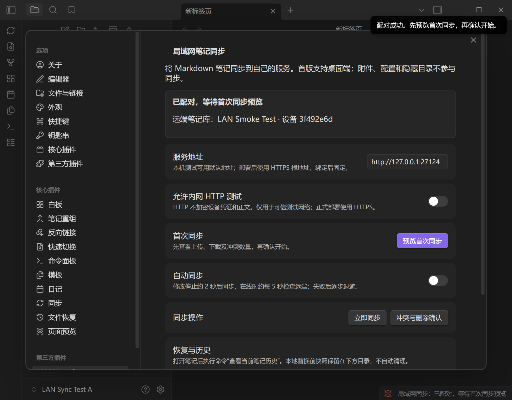
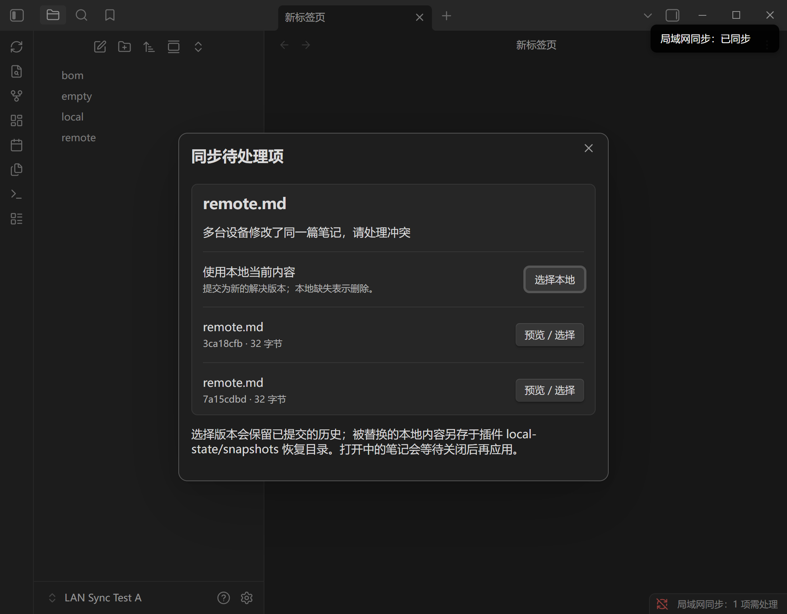
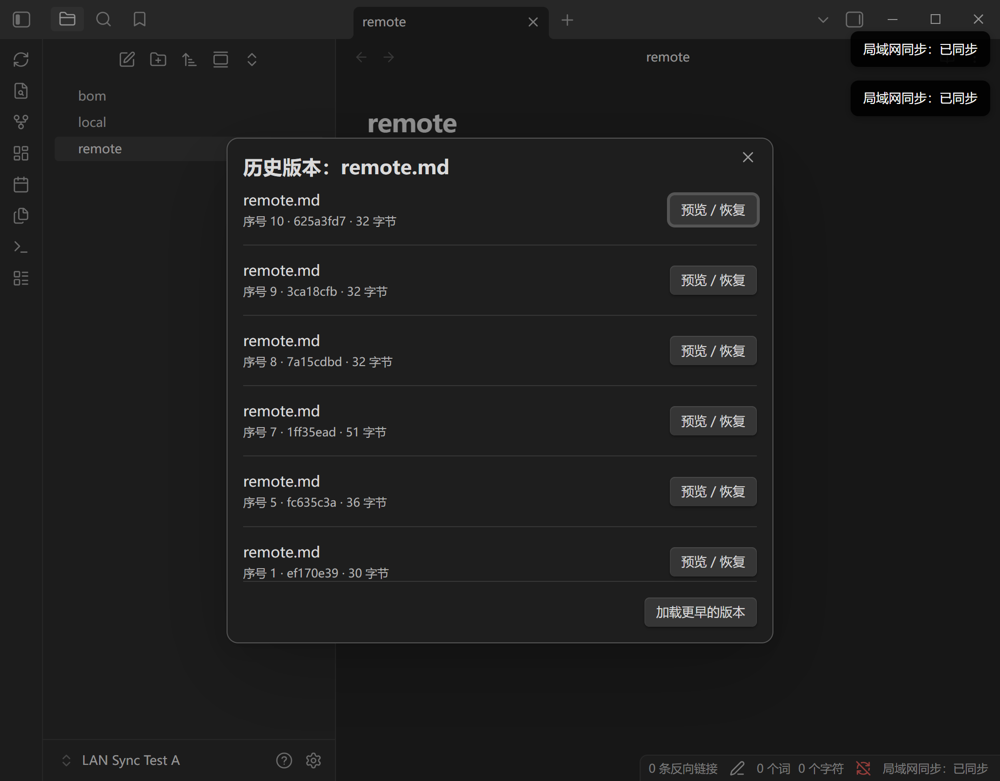

# LAN Note Sync v0.2 验证记录

> 归档：本文件不代表当前 CouchDB 版本的验收状态。当前记录见 [v0.3 测试报告](COUCHDB_TEST_REPORT.md)。

日期：2026-11-01。结论：**已形成可运行试用版本；不是所有平台和生产部署场景均已验收。**

## 环境与隔离

- Windows；Node.js 24.15.0，npm 11.12.1，实际内置 SQLite 3.51.3。
- Obsidian 1.12.7（installer 1.12.7），插件 `lan-note-sync` v0.2.0。
- 使用项目 `.test-runtime/obsidian-smoke/` 下新建的独立应用 profile、空白测试 Vault 和独立服务数据。
- 真实 Obsidian 通过 CLI 测试；第二端编辑由隔离测试工具提交，双客户端引擎由自动化测试通过真实 HTTP 服务验证。未把它描述为两台真实电脑实测。
- 未访问用户现有笔记，未写入飞书/GitHub，未部署到外部服务器。

## 自动化验证

`npm run build`：TypeScript 检查、插件与独立服务打包通过。

`npm test`：20 项通过，0 失败。测试在临时 SQLite 与真实回环 HTTP 上运行，使用可注入本地适配器测试竞争/故障；不能代替所有桌面文件系统行为。

| 测试 | 结果 |
|---|---|
| 状态原子落盘、独占锁、损坏 JSON 拒绝加载、快照字节 | 通过 |
| 双端原始字节同步、空文件、无回声循环 | 通过 |
| 离线同文件分叉、保留双方、显式解决 | 通过 |
| 初次同名不同内容不覆盖、显式选择 | 通过 |
| 改名保留身份、删除与离线编辑冲突 | 通过 |
| 服务端提交成功但回执丢失，客户端重启并保留后续编辑 | 通过 |
| 解决冲突回执丢失，重启后仍应用所选版本 | 通过 |
| 下载期间本地更改不被覆盖 | 通过（故障注入适配器） |
| 本地状态持久化失败时不发布新修订 | 通过 |
| 发送端与接收端批量删除精确确认 | 通过 |
| 本地写入后基线保存失败，通过 applying 日志恢复 | 通过 |
| 服务 epoch 变化，全量重新协调 | 通过 |
| 恢复旧服务端历史时不回退较新本地基线 | 通过 |
| 并发新建同名文件，改名后恢复且双方保留 | 通过 |
| 地址校验、TLS 要求、HTTP 测试开关 | 通过 |
| 配对码一次性/过期、Vault 授权隔离、设备撤销 | 通过 |
| 中文/BOM/CRLF/空字节对象、哈希及 UTF-8 拒绝、跨 Vault 隔离 | 通过 |
| 同父版本并发、幂等重发、复用 ID 不同 payload 拒绝、合并 | 通过 |
| 非法路径、大小写/文件目录占用、未知父节点、设备冒用 | 通过 |
| 105 条日志分页、epoch 校验、备份与恢复后历史/对象可读 | 通过 |

## 真实 Obsidian 验证

1. 在隔离 profile 注册测试 Vault，复制构建产物，加载插件；未配对状态正确。
2. 生成一次性码并通过插件配对；配置中未出现 token 字段，设备凭证存于 SecretStorage。
3. 预览得到本地 1 篇、远端 3 篇，预计上传 1、下载 3、冲突 0，符合样本。
4. 初次双向同步后 `local.md`、`remote.md`、`bom.md`、`empty.md` 共 4 篇；待提交为 0。
5. 再次修改远端普通笔记及含 BOM/CRLF 笔记后，插件更新成功。独立磁盘读取的全部正文 SHA-256 与远端头一致；BOM 样本仍有 `EF BB BF`，空文件长度为 0。
6. 在编辑器打开 `remote.md` 后更新远端：插件提示关闭后同步，本地保持旧内容；关闭后正常应用。
7. 真实 Vault 本地与测试第二端并发修改：产生 2 个 heads，显示冲突界面。选择第二端版本后 heads 为 1，本地所选内容正确，覆盖前快照保留。
8. 远端删除 `empty.md` 后，测试 Vault 的本地文件进入 `.trash/empty.md`。
9. 历史界面展示多个修订；恢复最初版本会生成新修订，本地内容回到初始样本，原历史仍保留。
10. 插件重新加载后读回基线与凭证，再次同步成功，待提交为 0。
11. CLI 在线备份成功生成独立备份目录。
12. 最后加载与同步检查：`dev:errors` 无错误；开启 debugger 后 `dev:console level=error` 无消息。
13. 使用最终版本重启隔离服务并重载插件，epoch 更新后的基线核对通过；真实定时自动上传与自动下载均成功，最终待提交为 0。实测发现成功后的等待时间与轮询节拍叠加会延迟检查，已移除成功等待，仅在失败后退避，并重新验证约 5 秒轮询。

界面截图：

截图通过 Obsidian CLI 获取，并等待实际渲染后检查；正文均为生成的测试样本。

## 尚未验收

- macOS、Android/iOS、两台真实电脑跨网络通信。
- NAS/Docker 容器实跑、HTTPS 证书信任与反向代理部署、服务守护与升级。
- 真实断电/硬盘损坏、Windows 外部进程极窄竞争窗口、跨路径移动的所有中间故障。
- 最大容量性能、长期高频编辑、超过 10000 逻辑文件及历史清理。
- 仅改变路径大小写、关闭插件期间同时改名与编辑、用户手工复制状态目录等复杂场景。
- 端到端加密、附件和配置同步。

测试结果支持在测试 Vault 中试用，不代表可以跳过独立备份或直接推广到所有真实资料。
